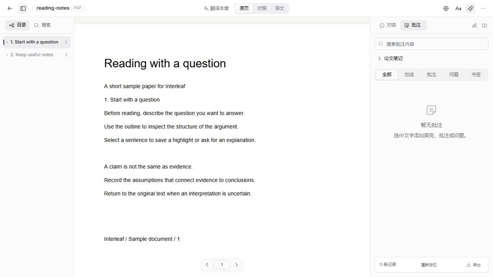
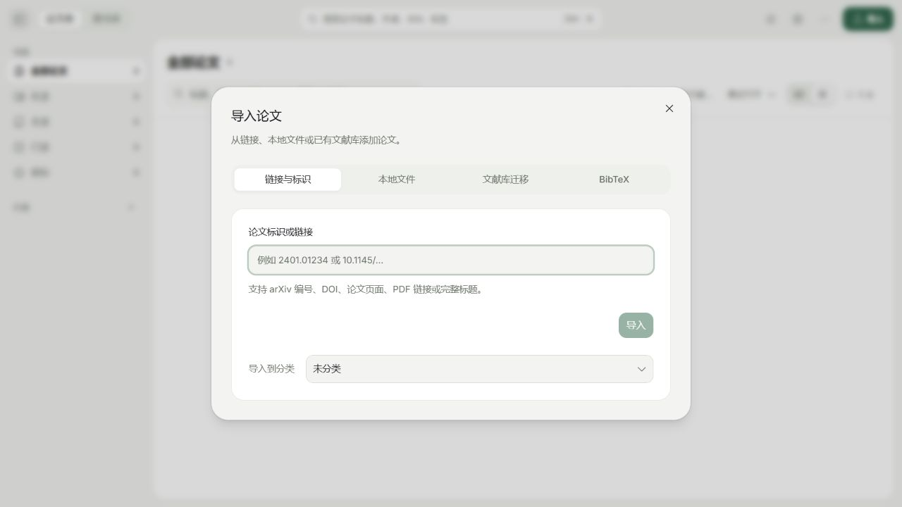
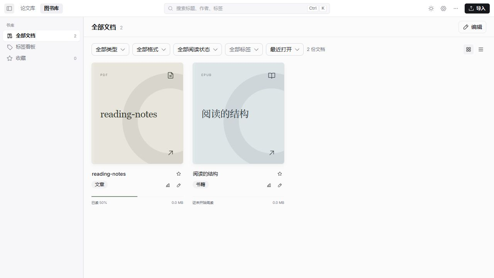
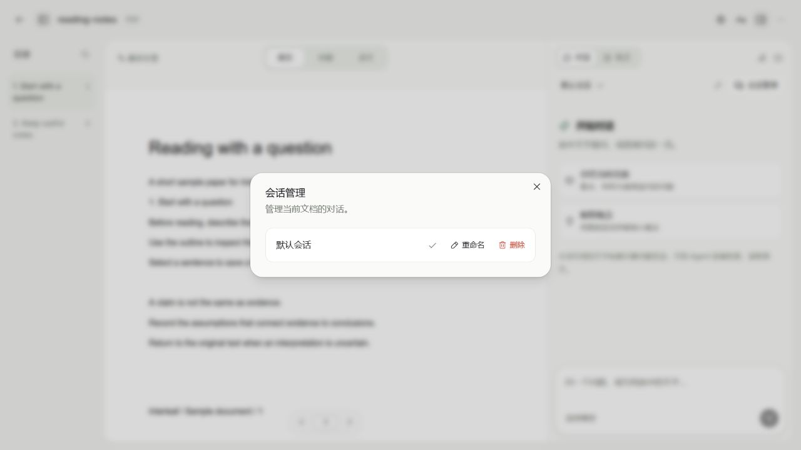

<p align="center">
  
</p>

<h1 align="center">Interleaf · 纸间</h1>

<p align="center">A local-first EPUB/PDF reader for managing papers, bilingual reading, annotations, and AI assistance grounded in the source.</p>
<p align="center"><a href="README.md">简体中文</a> · <b>English</b> · <a href="https://github.com/Tazewell/Interleaf/releases">Download</a> · <a href="https://github.com/Tazewell/Interleaf/issues">Report an issue</a></p>

<picture>
  <source media="(prefers-color-scheme: dark)" srcset="website/assets/screenshots/interleaf-pdf-dark.jpg" />
  
</picture>

Keep books and papers on your computer, organize references, mark passages, and record questions. Connect your own model service when you need assistance. Reading positions, annotations, notes, and conversations are saved with each document so you can pick up where you left off.

## What you can do

| Reading task | Interleaf features |
| --- | --- |
| Organize books and papers | Separate book and paper libraries; categories, tags, favorites, and reading states; paper metadata, duplicate detection, related documents, and customizable table columns. |
| Collect references | Import local EPUB/PDF files; find papers by DOI, arXiv ID, URL, or full title; migrate material from Zotero, EndNote, or BibTeX. |
| Read with questions in mind | Outlines, full-text search, bookmarks, highlights, underlines, and notes; saved reading positions and links from annotations or valid answer sources back to the original. |
| Read across languages | Original, side-by-side, and translated PDF views; chapter translation for EPUB; synchronized scrolling, selection translation, and custom translation instructions. Translation requires a configured model service. |
| Ask about your sources | Attach text or images and keep multiple conversations per document. Models with tool support can search and read the source as needed; image-capable models can inspect PDF pages. Research can also span documents in a category. |
| Export your work | Markdown, ZIP bundles with images, and annotated copies of original PDFs; the desktop app also exports bilingual PDFs. Citations in GB/T 7714, APA, BibTeX, BibLaTeX, RIS, and CSL-JSON. |

The desktop app also provides shortcuts, proxy settings, diagnostic exports, a movable library, and in-app updates. The `interleaf` command can search, read, and import local documents while the app is running.

## Start with a paper

The following workflow uses the deep learning paper [Attention Is All You Need (Vaswani et al., 2017)](https://arxiv.org/abs/1706.03762) to demonstrate importing, organizing, and reading a paper.

The interface images are existing repository screenshots captured on **2026-11-05**. They show bundled sample documents, rather than the paper above, in a separate demonstration library without personal API configuration or model answers. The main reader and library images follow GitHub's light or dark appearance.

### 1. Import your sources

Choose import in the paper library and paste `1706.03762`, a DOI, or a paper URL, or select a local PDF. You can choose a category before importing. Existing Zotero and EndNote libraries can be scanned for a migration preview first.



### 2. Organize and find

Group papers by category and tag, filter by reading state, and choose the table columns you need. PDF text indexing runs separately from detailed layout analysis: you can open the original first and search once its text index is ready.

<picture>
  <source media="(prefers-color-scheme: dark)" srcset="website/assets/screenshots/interleaf-library-dark.jpg" />
  
</picture>

### 3. Read, annotate, and ask

Use the outline or search to find a passage, then select text to highlight, underline, or annotate. For AI assistance, attach text or an image, write your question, and send it. Each document can keep several independent conversations. Configure a translation model to translate a document, chapter, or selection as needed.



## Install and run

Download an installer from [GitHub Releases](https://github.com/Tazewell/Interleaf/releases). The current release target is **Windows x64**, with files named `Interleaf-VERSION-win-x64.exe`. Packaged builds include the local server and PDF processor; no separate Node.js, Go, Python, or PaddlePaddle installation is needed.

Windows installers currently have no trusted developer signature. You can verify downloads against the release's `SHA256SUMS.txt`.

### Run the desktop app from source

Prepare **Node.js 22+, pnpm 10.30.3, and Go 1.26.5+**. Install dependencies and run the app in the same operating-system environment:

```sh
git clone https://github.com/Tazewell/Interleaf.git
cd Interleaf
pnpm install --frozen-lockfile
pnpm desktop
```

The first build downloads and verifies approximately **67 MB** of local PDF layout-model weights and needs network access. An empty book library offers bundled sample documents.

### Browser preview and WSL

`pnpm dev` builds the processor and server, then starts the local backend and Vite. You can use this workflow in WSL: prepare the toolchain, install dependencies, and start development inside WSL, then open the complete printed URL in a Windows browser.

```sh
cd /path/to/Interleaf
pnpm install --frozen-lockfile
pnpm dev
```

The default preview URL looks like `http://127.0.0.1:5173/#token=…`. Keep the `#token=…` fragment: it authenticates local API access. Do not publish a URL containing the token. Browser previews do not require Electron. WSL cannot build Windows installers; packaging requires native Windows x64.

## AI configuration and local data

Local reading, search, and annotations work without AI. In **Settings → AI**, choose a provider or custom endpoint, enter the key and protocol, and select models for chat, translation, images, and research. OpenAI-compatible and Anthropic protocols are supported, with endpoint presets for DeepSeek, Alibaba Bailian, Kimi, Zhipu, and MiniMax. The built-in Go runtime calls the model service directly; no external AI command-line tools are required.

Image and tool support depend on the model and endpoint and can be checked in model settings. Once a usable model service is configured, newly imported PDF papers of **50 pages or fewer** are translated automatically by default. Change the page threshold in **Settings → Paper library → Import settings**, or set it to **0** to disable automatic translation for new imports. Automatic selection translation is off by default and can be enabled in **Settings → Reading**. Online research requires separate permission.

- **Local storage:** original files, SQLite data, reading history, annotations, translations, notes, and conversations are stored in the library directory. There is no built-in cloud sync.
- **Model requests:** AI features send the required source text, selections, images, and conversation context to your configured model service. Online research also queries public scholarly sources. Billing and data handling follow the service's policies.
- **Paper metadata:** PDF imports look up metadata online by default, sending only DOI or arXiv identifiers found in the document. Disable this in **Settings → Paper library → Import settings**.
- **Configuration and backups:** API keys are saved in the library's `ai-connections.json`; saved keys are not returned to the UI. Quit the app before backing up, and remove keys and other private configuration before sharing a library.
- **Library location:** Windows packaged builds default to `%APPDATA%\Interleaf\library\`, and development desktop builds use `%APPDATA%\Interleaf Dev\library\`. Browser development uses the project's `.interleaf/`. Desktop users can move the entire library in **Settings → Paper library → Library location**; the original directory is retained.

## Development

```sh
pnpm typecheck     # TypeScript checks
pnpm test          # Go and frontend tests
pnpm build         # Processor, server, web, desktop, and browser connector
pnpm package       # Build installers on native Windows x64
```

```text
apps/
├── web/                 React UI, Readium EPUB, and PDF.js reading engines
├── desktop/             Electron main process and native features
├── server/              Go local service, SQLite, AI, and interleaf CLI
├── processor/           Local PDF layout analysis, model, and PDF export
└── connector/           Browser connector
packages/
├── interleaf-core/      Shared document, position, and annotation types
├── api-client/          OpenAPI types and client
└── ui/                  shadcn/ui and Base UI components
docs/                    API definition and release notes
website/                 Static website and interface screenshots
```

The browser connector currently requires manual loading: run `pnpm --filter @interleaf/connector build`, enable developer mode in Chrome's extension manager, and load `apps/connector/dist/`. Connector access is disabled in development by default; set `INTERLEAF_DEV_CONNECTOR=1` before starting development to enable it.

For releases, maintainers must synchronize the root and desktop package versions and update the [in-app release notes](docs/release-notes.json). See the [release workflow](.github/workflows/release.yml) and [Windows build workflow](.github/workflows/build.yml) for validation and artifact generation.

## Current limitations

- No local OCR for scanned pages. Search and translation that depend on a text layer cannot fully process image-only PDFs.
- EPUB bilingual processing does not support fixed layouts, vertical text, or right-to-left books.
- Text extraction, reading order, and translated layouts in complex PDFs may need manual review.
- Imports are limited to **512 MB per file**. PDFs exceeding **100 pages or 100 MB** require extra confirmation when added to the paper library.
- macOS and Linux installers are outside the current release workflow. Native installation and cross-version upgrades still require platform verification.

## Feedback and acknowledgements

Report bugs and suggestions through [GitHub Issues](https://github.com/Tazewell/Interleaf/issues). For parsing or connection problems, include exported diagnostics where useful, along with your OS version, file type, and reproduction steps.

Thanks to Readium, PDF.js, shadcn/ui, Base UI, and the other dependencies used by Interleaf. See the [layout-model notice](apps/processor/model-license/NOTICE.md) and [bundled-font documentation](apps/processor/fonts/README.md) for their sources and licenses. UI components retain their [upstream license](packages/ui/LICENSE.md).
