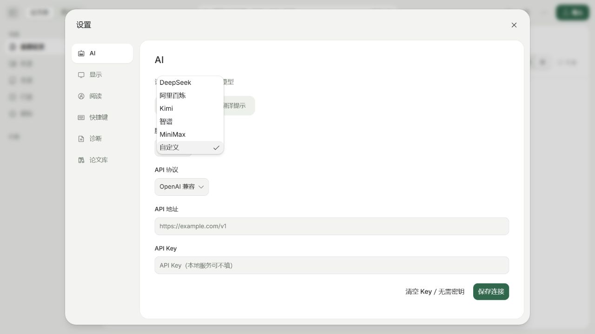
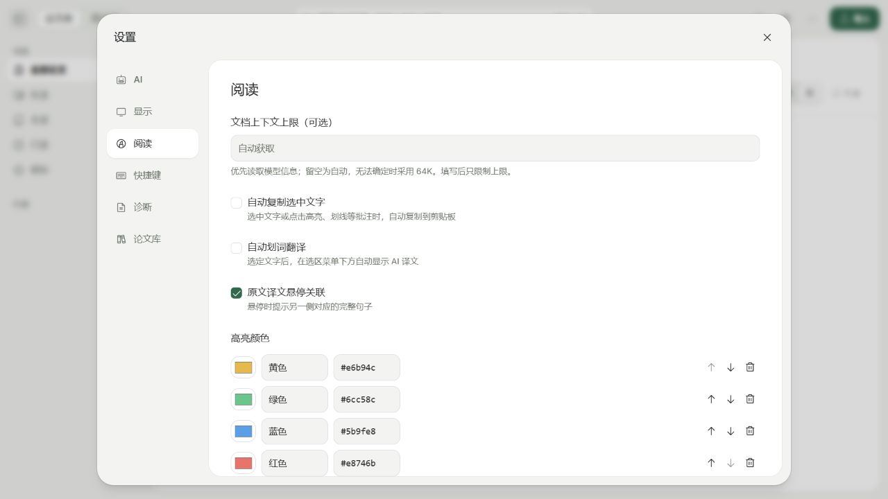
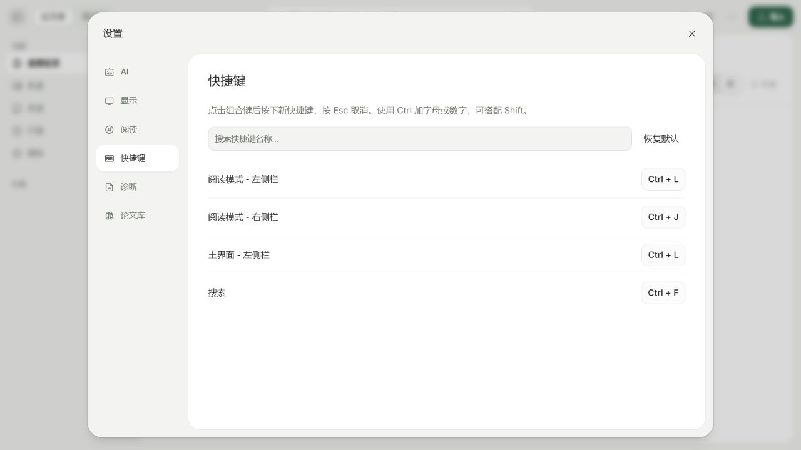
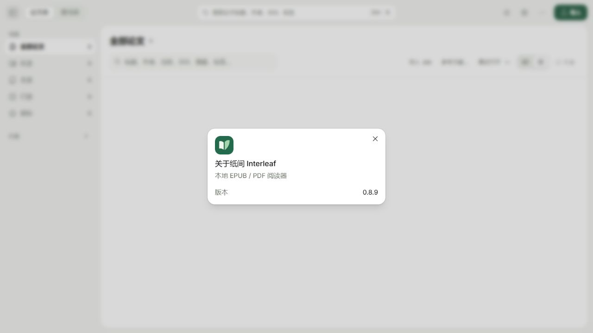

<p align="center">
  
</p>

<h1 align="center">Interleaf · 纸间</h1>

<p align="center">A local-first EPUB/PDF reader for papers and books, with bilingual translation, annotations, notes, and AI-assisted reading.</p>
<p align="center"><a href="README.md">简体中文</a> · <b>English</b> · <a href="https://github.com/Tazewell/Interleaf/releases">Releases</a></p>

<picture>
  <source media="(prefers-color-scheme: dark)" srcset="website/assets/screenshots/interleaf-pdf-dark.jpg" />
  
</picture>

Interleaf keeps books and papers in separate libraries, with original files, notes, and reading history on your computer. Connect your own OpenAI- or Anthropic-compatible API for questions, translation, and research across your documents.

> `main` includes the updated interface, session management, and optional selection translation. An installer containing these changes has not been released yet.

## Features

- **Consistent interface:** rounded library, reader, import, and settings views; a sliding reading-mode switch and a chat toolbar embedded in the reading sidebar.
- **Libraries for books and papers:** import EPUB/PDF, organize documents with categories, tags, reading states, and favorites; manage paper metadata, duplicates, related documents, and batch actions.
- **Reading and annotations:** contents, text search, bookmarks, highlights, underlines, questions, notes, reading-position restoration, filtering, undo, and exports. Light, dark, and paper appearances are available.
- **Bilingual reading:** original, side-by-side, and translated PDF views; chapter translation and linked source/translation reading for EPUB. Optional automatic selection translation displays results below the selection toolbar. Layout analysis runs locally; translation needs a configured API.
- **AI reading and research:** attach text or images and type your own question, then follow answer sources back to the original. Submitted references clear from the composer. Create, switch, rename, and delete sessions per document, or research documents across a category. Online research requires separate authorization.
- **Import and citations:** DOI, arXiv, URL, or title import; Zotero migration, a browser connector, and GB/T 7714, APA, BibTeX, and RIS exports.
- **Desktop and terminal:** Electron desktop app, in-app updates, proxy settings, diagnostic exports, editable shortcuts, and the `interleaf` command for searching, reading, and importing library documents.

The browser extension is not published to a store yet. Build `apps/connector`, enable developer mode in Chrome, and load its generated `dist/` directory.

## Screenshots

Captured from the current `main` on **2026-11-05**, using bundled original sample documents in a separate demonstration library, without personal library data or API configuration. Light/dark variants follow GitHub's appearance.

### Library

<picture>
  <source media="(prefers-color-scheme: dark)" srcset="website/assets/screenshots/interleaf-library-dark.jpg" />
  
</picture>

### Paper import


### AI settings



### Reading settings



### Session management


### Keyboard shortcuts



### Interleaf identity



## Install or run from source

Installers are distributed through [GitHub Releases](https://github.com/Tazewell/Interleaf/releases). Currently only **Windows x64 EXE** installers are published. Download `Interleaf-VERSION-win-x64.exe` and follow the setup wizard. If no installer is available yet, run from source.

Windows installers currently have no trusted developer signature. Check the download source and `SHA256SUMS.txt`; Windows may show a first-run security prompt.

### Run from source

Requires **Node.js 22+, pnpm 10.30.3, and Go 1.26.5+**:

```sh
git clone https://github.com/Tazewell/Interleaf.git
cd Interleaf
pnpm install --frozen-lockfile
pnpm desktop
```

Use `pnpm dev` for the browser development preview. Open the complete local URL printed in the terminal; it includes a temporary authentication token and must not be published. An empty book library offers bundled sample documents.

The first build downloads and verifies approximately 67 MB of local layout-model weights. End users of packaged builds do not need Node.js, Go, Python, or PaddlePaddle.

## AI configuration and data

Local reading, search, and annotations work without AI. In **Settings → AI**, enter your API endpoint, key, and protocol, then choose models for chat, translation, images, and research. The built-in Go runtime calls that service directly; no external Codex, Claude Code, or Kimi CLI installation or login is required.

Automatic selection translation is off by default. Enable **自动划词翻译** in **Settings → Reading** or the selected-text **更多文字操作** menu. It uses your configured translation model.

The key is stored by the local backend; the UI only reports whether one is configured. Model requests send the required passages, excerpts, images, and conversation context to your chosen service. Online research also queries public scholarly sources. Billing and data policies depend on the configured provider.

- Packaged libraries default to `Interleaf/library/` under the application user-data directory. Development desktop data uses `Interleaf Dev`; browser development uses the project's ignored `.interleaf/` directory.
- Original files, SQLite data, reading history, annotations, and conversations stay local. No built-in cloud sync is provided.
- Quit the app before backing up a library. A complete library may contain API configuration; remove private information before sharing it.


## Development

```sh
pnpm typecheck     # TypeScript checks
pnpm test          # Go and frontend tests
pnpm build         # Server, processor, web, desktop main process, and connector
pnpm package       # Native Windows x64 EXE installer build
```

```text
apps/
├── web/                 React UI and EPUB/PDF engines
├── desktop/             Electron main process and native features
├── server/              Go local service, SQLite, and AI runtime
├── processor/           Local PDF layout analysis and model
└── connector/           Browser connector
packages/
├── interleaf-core/      Shared document, position, and annotation types
├── api-client/          API client and generated types
└── ui/                  shadcn/ui and Base UI components
website/                 Static website and current screenshots
assets/                  Interleaf identity and platform icons
```

Scanned-page OCR is not available. Fixed-layout EPUB, vertical text, RTL, and complex PDF layouts need more validation. macOS and Linux installers are not currently published. Native installation and cross-version upgrades still require manual verification.

## Publishing and updates

Keep the root and `apps/desktop/package.json` versions in sync and add notes for that version to `docs/release-notes.json`. Run checks, then execute `pnpm package` on native Windows x64. Installers are written to `release/`.

The automated release workflow runs when a GitHub Release is **published**; pushing code or a tag alone does not publish installers. In **Releases → Draft a new release**, create a tag matching the app version (for example, `v0.8.7`), target the updated `main` commit, enter release notes, and click **Publish release**.

The pipeline builds Windows x64 only and needs no Mac signing secrets. Follow **Actions → Release installers**; after checks, packaging, and runtime verification pass, it attaches the EXE and `SHA256SUMS.txt` to a mutable Release. You can also run the workflow manually to download and verify build artifacts first. For immutable releases, build manually and attach the installer and checksums to the draft before publishing; the published event skips building and uploading so locked assets stay intact.

Before the first release, verify installation, imports, reading, note persistence, and reopening. Use two actual installed versions to check that updates preserve data. A stable Release must include installers and `SHA256SUMS.txt`; installed apps check `Tazewell/Interleaf` for updates.

## Feedback and acknowledgements

Report problems or suggest features through [GitHub Issues](https://github.com/Tazewell/Interleaf/issues).

Thanks to Readium, PDF.js, shadcn/ui, Base UI, and the other projects used by Interleaf. Their license, font, and model notices remain in the source tree.
