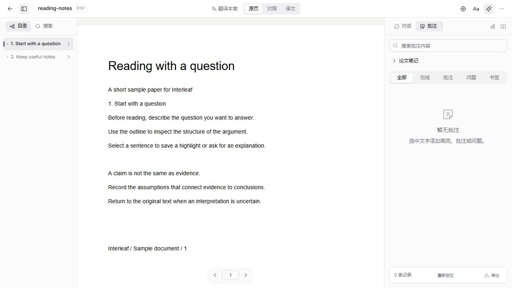
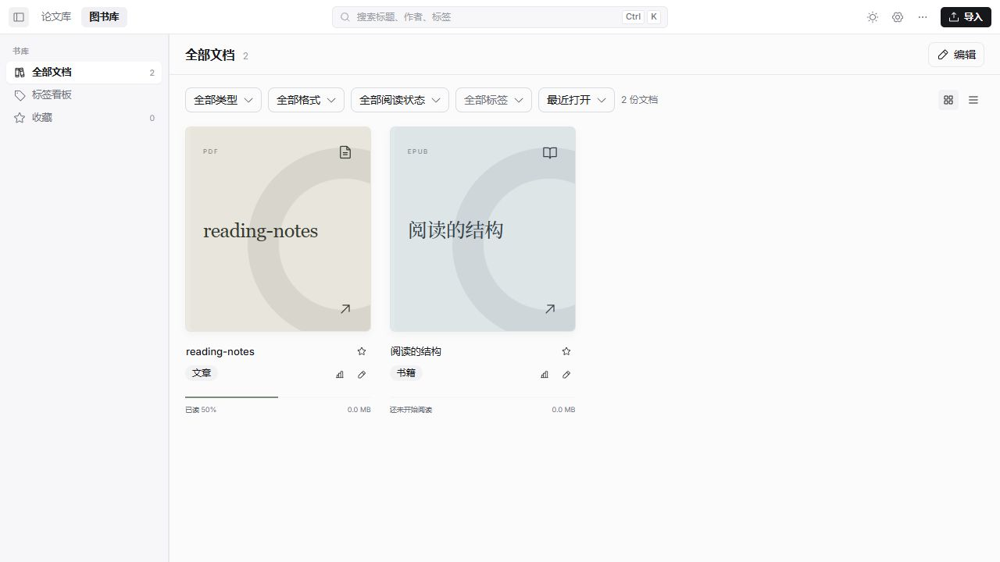
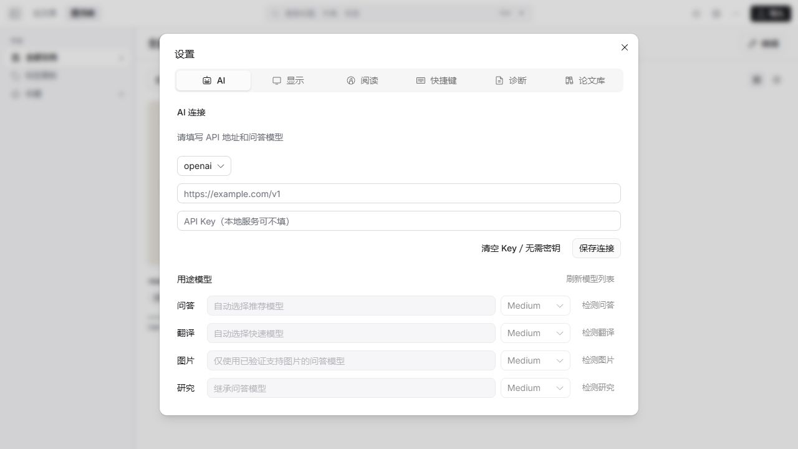
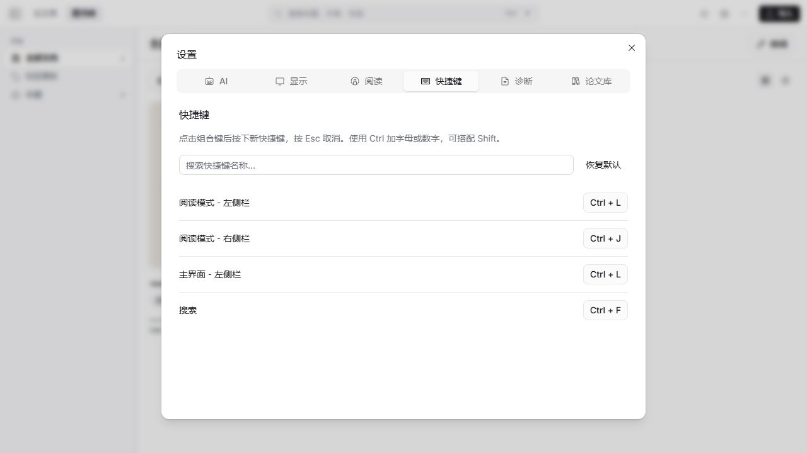
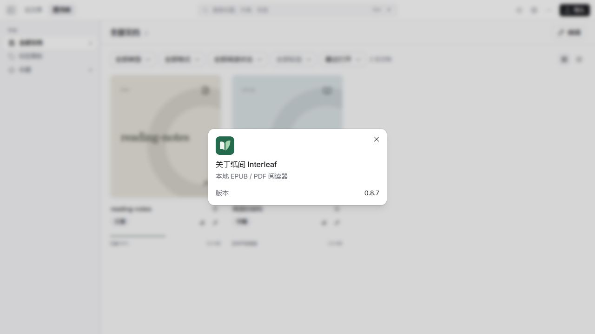

<p align="center">
  
</p>

<h1 align="center">纸间 Interleaf</h1>

<p align="center">本地优先的 EPUB / PDF 阅读器，支持论文管理、双语对照翻译、批注笔记与 AI 辅助精读。</p>
<p align="center"><b>简体中文</b> · <a href="README.en.md">English</a> · <a href="https://github.com/Tazewell/Interleaf/releases">版本下载</a></p>

<picture>
  <source media="(prefers-color-scheme: dark)" srcset="website/assets/screenshots/interleaf-pdf-dark.jpg" />
  
</picture>

纸间将图书与论文分开管理，让原文、笔记和阅读记录保存在自己的电脑上。需要 AI 时，可配置自己的 OpenAI 或 Anthropic 兼容 API，在阅读过程中提问、翻译或围绕资料开展研究。

## 功能

- **图书与论文书库**：导入 EPUB / PDF，按分类、标签、阅读状态与星标整理文档；论文支持元数据补全、重复检测、关联文献和批量操作。
- **阅读与批注**：目录与全文搜索、书签、高亮、下划线、问题和笔记；保存阅读位置，支持批注筛选、撤销与导出。界面提供浅色、深色和纸张外观。
- **双语阅读**：PDF 原文、对照与译文视图；EPUB 按章翻译和原译文联动。PDF 版面解析在本地进行，翻译需要可用的 API 连接。
- **AI 精读与主题研究**：引用原文提问，阅读可定位的回答来源；为文档维护独立会话，围绕分类中的资料生成综述、比较与研究想法。联网研究需单独授权。
- **收录与引用**：从 DOI、arXiv、链接或标题导入，支持 Zotero 迁移、浏览器收录扩展，以及 GB/T 7714、APA、BibTeX、RIS 引用导出。
- **桌面与命令行**：Electron 桌面应用、应用内更新、代理设置、诊断导出和自定义快捷键；`interleaf` 命令可检索、阅读和导入本机书库。

浏览器收录扩展尚未上架。当前可构建 `apps/connector`，在 Chrome 扩展管理中开启开发者模式，加载生成的 `dist/` 目录。

## 当前界面

以下图片于 **2026-10-31** 从当前版本实际截取，使用独立演示书库中的项目自带示例文档。图片不包含个人聊天记录、API Key 或真实服务地址；浅色与深色图片会跟随 GitHub 外观切换。

### 书库

<picture>
  <source media="(prefers-color-scheme: dark)" srcset="website/assets/screenshots/interleaf-library-dark.jpg" />
  
</picture>

### AI 设置



### 快捷键



### 纸间标识



## 安装与运行

安装包入口为 [GitHub Releases](https://github.com/Tazewell/Interleaf/releases)，具体版本与平台以 Release 附件为准。项目支持构建 Windows x64 EXE 与 Apple Silicon macOS DMG；可在原生 Windows 或 macOS 环境构建对应平台的安装包。若页面尚无安装包，可从源码运行。

当前安装包尚无系统信任的开发者签名或 macOS 公证。下载后请核对来源和校验文件，系统首次运行可能出现安全提示。

### 从源码运行

准备 **Node.js 22+、pnpm 10.30.3、Go 1.26.5+**：

```sh
git clone https://github.com/Tazewell/Interleaf.git
cd Interleaf
pnpm install --frozen-lockfile
pnpm desktop
```

开发浏览器预览可执行 `pnpm dev`。终端会输出带临时鉴权 token 的本机地址，使用完整地址打开，勿将该地址发布到仓库。空图书库中可点击“先体验示例文档”。

首次构建会下载并校验约 67 MB 的本地版面模型；终端用户使用已打包版本时无需安装 Node.js、Go、Python 或 PaddlePaddle。

## AI 配置与数据

本地阅读、搜索和批注不依赖 AI。启用 AI 时，在 **设置 → AI** 中填写 API 地址、Key 和协议，分别选择问答、翻译、图片及研究模型。内置 Go 运行时直接调用配置的模型服务；不需要安装或登录 Codex、Claude Code、Kimi 等外部 AI CLI。

API Key 由本机后端配置保存，界面只显示是否已配置。调用模型时，所需原文、选区、图片和会话上下文会发送给你配置的服务；联网研究还会查询公开学术来源。模型服务的费用与数据政策由对应服务决定。

- 安装版书库默认位于应用用户数据目录的 `Interleaf/library/`；开发桌面使用 `Interleaf Dev`，浏览器开发使用项目内 `.interleaf/`。
- 原始文件、SQLite 数据库、阅读记录、批注和会话保存在本机，未内置云同步。
- 备份前先退出应用。完整书库可能包含 API 配置，分享或上传前需移除私密信息。


## 开发

```sh
pnpm typecheck     # TypeScript 类型检查
pnpm test          # Go 与前端测试
pnpm build         # 构建服务、处理器、Web、桌面主进程与扩展
pnpm package       # 在原生 Windows / macOS 环境生成安装包
```

```text
apps/
├── web/                 React 界面与 EPUB / PDF 阅读引擎
├── desktop/             Electron 主进程与原生能力
├── server/              Go 本地服务、SQLite 与 AI 运行时
├── processor/           PDF 版面解析与本地模型
└── connector/           浏览器收录扩展
packages/
├── interleaf-core/      文档、定位、批注及共享类型
├── api-client/          API 客户端与生成类型
└── ui/                  shadcn/ui 与 Base UI 组件
website/                 静态官网与当前界面截图
assets/                  纸间标识与平台图标
```

扫描件尚不支持 OCR；固定版式 EPUB、竖排、RTL 和复杂 PDF 排版仍需更多验证。当前没有 Linux 安装包。实际安装、系统签名提示和跨版本升级仍需原生平台验收。

## 发布与更新

先同步根目录和 `apps/desktop/package.json` 的版本号，并为该版本填写 `docs/release-notes.json`。运行检查后，在原生 Windows / macOS 环境执行 `pnpm package`，安装包生成在 `release/`。

GitHub 自动发布工作流由 **发布 Release** 触发，单独推送代码或 tag 不会生成正式附件。当前流水线同时构建 Windows x64 与 Apple Silicon macOS；Mac 正式构建需要仓库 Secrets `MAC_SIGN_P12` 和 `MAC_SIGN_P12_PASSWORD`，任一平台失败都会阻止统一上传。

首次发行前，先用测试安装包验收导入、阅读、笔记保存与重新打开，再用两个真实安装版本验收升级后数据保留。正式 Release 需提供安装包和 `SHA256SUMS.txt`；已安装应用从 `Tazewell/Interleaf` 检查更新。

## 反馈与致谢

使用中遇到问题或有功能建议，请提交 [GitHub Issue](https://github.com/Tazewell/Interleaf/issues)。

感谢 Readium、PDF.js、shadcn/ui、Base UI 等项目。源码中的第三方许可、字体和模型来源说明会保留。
